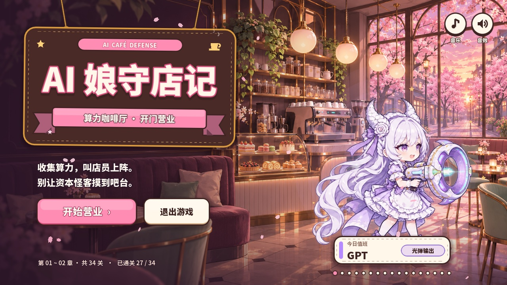
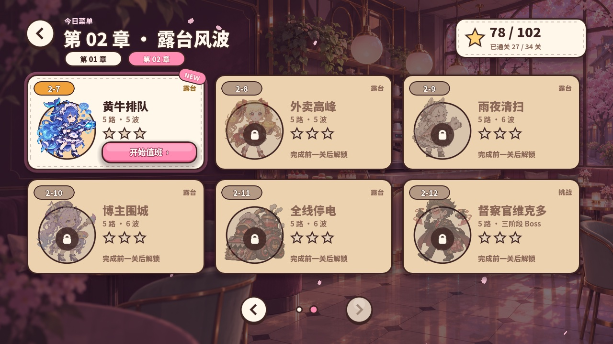
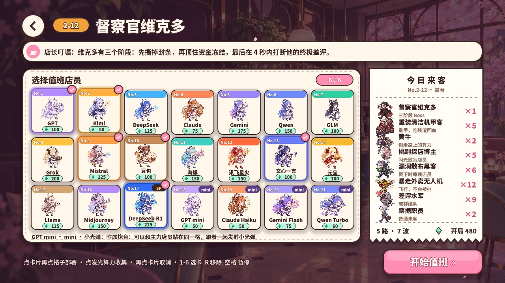
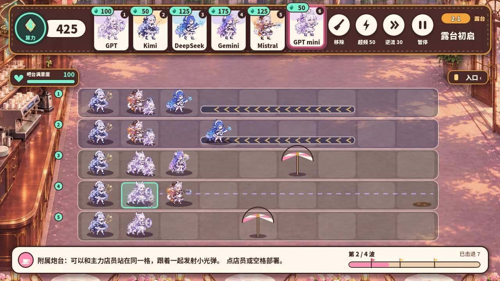
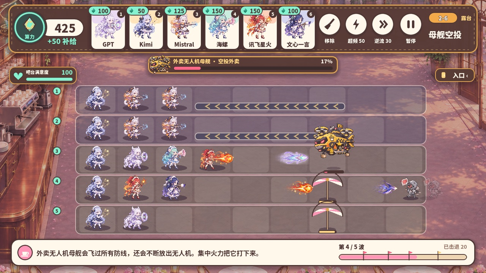
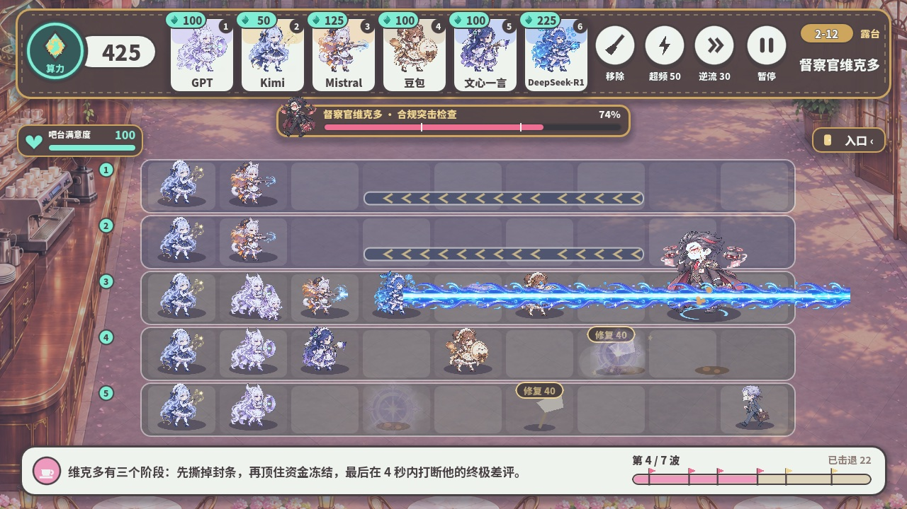

# AI 娘守店记 · AI Café Defense

收集算力，叫 AI 店员上阵，别让资本怪客摸到吧台！

一款樱花咖啡厅主题的横版塔防小游戏：21 位 AI 娘（含 SP 与 mini）化身店员，在五条走道上拦住络绎不绝的「来客」。
共两章 34 关：第 01 章「算力咖啡厅」22 关，第 02 章「露台风波」12 关。

**引擎**：Godot 4.7（GL Compatibility 渲染）· **平台**：Windows / macOS / Android · **分辨率**：1280×720

| | |
|:---:|:---:|
|  |  |
| 标题 | 今日菜单（第 02 章） |
|  |  |
| 21 位店员任选 6 位 | 露台战场：传送带、遮阳伞、mini 附属炮台 |
|  |  |
| 中 Boss：外卖无人机母舰 | 最终 Boss：督察官维克多 |

## 玩法

- 场上会定时掉落发光的**算力**，点击收集，用来部署店员。
- 每位店员占一格，会自动攻击同一路的来客。
- **第 01 章**（22 关，1-0 至 1-20EX）：每条走道的清洁机器人可以救场**一次**，同一路第二次被突破就算失守；按剩余机器人数量评星。
- **第 02 章**（12 关，通关 1-20 后开放）：改用「吧台满意度」，来客漏过会扣分；场上有传送带、超频充电桩、遮阳伞，还有停电和骤雨事件；可以带 6 位店员。

### 第 02 章的新玩法

- **AI 娘**：8 位新店员都对应真实的 AI，造型取自各自的社区形象。
- **SP**：同一个 AI 换造型、换能力的特别版，本章是 DeepSeek-R1。
- **mini 附属炮台**：用各家小模型命名，便宜、能力弱，可以和主力店员站在**同一格**，也能单独放。
- **场景设施**：传送带「逆流」把来客推回去（`E`）；充电桩给店员「超频」（`Q`）；被打坏的遮阳伞可以修。

完整的数值、关卡表和设计说明见 [第 02 章开发文档](docs/第2章开发文档.md)。

### 店员

| 店员 | 定位 | 算力 | 解锁 | 能力 |
|---|---|---:|---|---|
| GPT | 光弹输出 | 100 | 1-0 | 向同一路发射光弹 |
| Kimi | 算力支援 | 50 | 1-1 | 部署 8 秒后开始产出算力 |
| DeepSeek | 水炮减速 | 125 | 1-2 | 水弹减速 30%，持续 3 秒 |
| Claude | 书盾防御 | 75 | 1-3 | 四倍耐久，挡住同路来客 |
| Gemini | 邻路支援 | 175 | 1-5 | 同时攻击本路和两条相邻路线 |
| Qwen | 折扇破甲 | 150 | 1-7 | 扇刃对护盾和装甲造成双倍伤害 |
| GLM | 扫描解封 | 100 | 1-9 | 揭示潜行来客，解除炮台封锁 |
| Grok | 爆发溅射 | 200 | 1-11 | 星弹命中时波及同路一格内的来客 |
| Mistral | 寒风狙击 | 125 | 2-1 | 冰弹减速，连中 3 发冻结 |
| 豆包 | 暖心守护 | 100 | 2-2 | 挡路、横扫三路，治疗身边店员 |
| 海螺 | 声波穿透 | 150 | 2-3 | 声波贯穿整路 |
| 讯飞星火 | 星火燎原 | 150 | 2-5 | 点燃来客，倒下时把火传给同伴 |
| 文心一言 | 一言标记 | 100 | 2-6 | 被标记的来客受到的伤害 +25% |
| 元宝 | 招财进宝 | 100 | 2-8 | 产出 40 算力的金元宝 |
| Llama | 毛球击退 | 125 | 2-9 | 把来客往后推半格 |
| Midjourney | 绘梦屏障 | 150 | 2-10 | 在前方画一道颜料墙 |
| DeepSeek-R1（SP） | 深度思考 | 225 | 2-7 | 思考 2 秒后发射贯穿整路的光束 |
| GPT mini（mini） | 小光弹 | 50 | 2-1 | 和主力同格，一起发射小光弹 |
| Claude Haiku（mini） | 俳句护盾 | 50 | 2-3 | 同格主力受到的伤害 −30% |
| Gemini Flash（mini） | 闪电加速 | 75 | 2-4 | 同格主力攻速 +25% |
| Qwen Turbo（mini） | 小破甲 | 60 | 2-7 | 小扇刃，对护盾和装甲双倍伤害 |

### 来客

| 来客 | 特点 |
|---|---|
| 票据职员 | 普通来客 |
| 快递猎手 | 跑得快 |
| 箱盾保镖 | 举着箱盾，先打掉护盾才伤得到本体 |
| 加班顾问 | 让同路附近的来客短时加速 |
| 潜行职员 | 潜行，躲开单体锁定；被扫描或被挡住时显形 |
| 特朗普 | 停下来举起扩音器，召来同路职员 |
| 达里奥 | 封住同路的炮台 |
| tibo | 潜行，而且很耐打 |
| 算力收购机甲 | 1-20EX 的三阶段 Boss：装甲、封锁、潜行随从 |
| 暴走外卖无人机 | 飞行，不会被挡 |
| 挑剔探店博主 | 闪光让前方店员停手 |
| 重装清洁机甲客 | 重甲，吃咖啡残渣回血 |
| 漏洞散布黑客 | 倒下时瘫痪击杀它的店员 |
| 差评水军 | 成群结队 |
| 黄牛 | 偷走路上的算力，打倒后吐出来 |
| 外卖无人机母舰 | 2-6 中 Boss：飞行，空投无人机 |
| 督察官维克多 | 2-12 最终 Boss：封条、资金冻结、终极差评 |

## 操作

| 操作 | 鼠标 / 触屏 | 键盘 |
|---|---|---|
| 选择店员卡 | 点击顶部卡片 | `1` ~ `6` |
| 部署 | 选卡后点击空格子 | — |
| 收集算力 | 点击发光的算力 | — |
| 移除店员 | 点「移除」再点店员 | `R` |
| 取消选择 | 再点一次卡片 | 鼠标右键 |
| 传送带逆流（第 02 章） | 点「逆流」 | `E` |
| 超频（第 02 章） | 点「超频」再点店员 | `Q` |
| 撕封条 / 修遮阳伞 | 点被封的店员 3 下 / 点残骸 | — |
| 暂停 / 继续 | 点「暂停」 | `空格` / `Esc` |

安卓上按返回键会暂停战斗，或返回上一页。

## 运行

1. 安装 [Godot 4.7](https://godotengine.org/download)（已在 4.7.2 上测试）。
2. 打开 Godot 项目管理器 →「导入」→ 选择本仓库根目录的 `project.godot`。
3. 第一次打开会自动导入图片和音频，等进度条走完。
4. 点右上角的 ▶ 运行（Windows / Linux 按 `F5`，macOS 按 `⌘B`）。

也可以用命令行运行：

```bash
godot --path . --import
godot --path .
```

## 导出安卓 APK

仓库里已经带了 `Android` 和 `Windows Desktop` 两个导出预设（`export_presets.cfg`）。安卓预设的包名是 `com.aicafe.defense.trial`，版本号 5（1.2.0）。

1. 在 Godot 里安装与编辑器版本一致的导出模板（编辑器 → 管理导出模板）。
2. 在「编辑器设置 → 导出 → Android」里填好 Android SDK 和 Java SDK 的路径。
3. 打开「项目 → 导出 → Android」，在 Keystore → Release 里填写**你自己的**签名密钥。
4. 点「导出项目」。

> 签名密钥（`.keystore` / `.jks`）千万不要提交到仓库。Godot 会把密钥密码单独存在 `.godot/export_credentials.cfg`，`.gitignore` 已经排除了整个 `.godot/` 文件夹。

## 工程结构

```
├── project.godot        工程设置
├── Main.tscn            主场景（只有一个 Node2D）
├── main.gd              界面、输入、特效、音乐与音效
├── battle.gd            战斗规则，并通过 events 通知界面发生了什么
├── campaign.gd          21 张卡、17 种来客与 34 个关卡的数据
├── export_presets.cfg   Android / Windows 导出预设
├── art/                 立绘、背景、特效贴图、字体
│   └── audio/           背景音乐（.ogg）和音效（.wav）
├── tools/               开发工具（Godot 不会导入）
│   ├── audio_gen.py     生成全部音乐和音效的脚本
│   ├── battle_tests.gd  战斗规则自动化测试
│   └── balance_sim.gd   第 02 章自动对局模拟
└── docs/                开发文档与 README 截图（Godot 不会导入）
```

整个界面都在 `main.gd` 的 `_draw()` 里即时绘制，没有使用 Control 节点，所以改 UI 时直接改对应的 `draw_*` 函数即可。

## 音乐与音效

所有音乐和音效都由 `tools/audio_gen.py` 用纯 Python 合成（不依赖任何采样素材）：

- 五首可无缝循环的背景音乐：菜单（Bossa 咖啡馆风）、第 01 章战斗（轻快日系）、第 01 章 Boss（小调）、第 02 章露台（Future Bass + Bossa）、第 02 章 Boss（电子摇滚 + 警报）。
- 67 个音效：门铃、算力收集、部署、各店员攻击、破盾、冻结、相机闪光、EMP、逆流、深度思考光束等。

修改脚本后重新生成：

```bash
python3 tools/audio_gen.py          # 全部重新生成
python3 tools/audio_gen.py sfx      # 只生成音效
python3 tools/audio_gen.py music    # 只生成音乐（需要带 libvorbis 的 ffmpeg）
```

## 测试

```bash
godot --headless --path . -s res://tools/battle_tests.gd    # 规则测试（含第 01 章逐帧回归）
godot --headless --path . -s res://tools/balance_sim.gd     # 第 02 章自动对局，输出每关胜负与满意度
```

## 存档

进度保存在 Godot 用户目录下的 `AICafeDefenseTrial` 文件夹里（`progress.dat` 是关卡星级，`audio-setting.txt` 是音乐/音效开关）：

- Windows：`%APPDATA%\AICafeDefenseTrial`
- macOS：`~/Library/Application Support/AICafeDefenseTrial`
- Android：应用私有存储

## 致谢与许可

- 本仓库采用 [MIT 许可证](LICENSE)，字体文件除外。
- 字体：[Noto Sans SC](https://fonts.google.com/noto/specimen/Noto+Sans+SC)，SIL Open Font License 1.1，许可证全文见 `art/OFL-NotoSansSC.txt`。
- 引擎：[Godot Engine](https://godotengine.org)（MIT 许可）。

## 免责声明

本作品是非官方的同人 / 戏仿小游戏，仅供娱乐。文中提到的 AI 产品名称和商标归各自公司所有，角色均为拟人化的二次创作；游戏内容与相关公司及人物没有任何关联，也不代表其立场。
